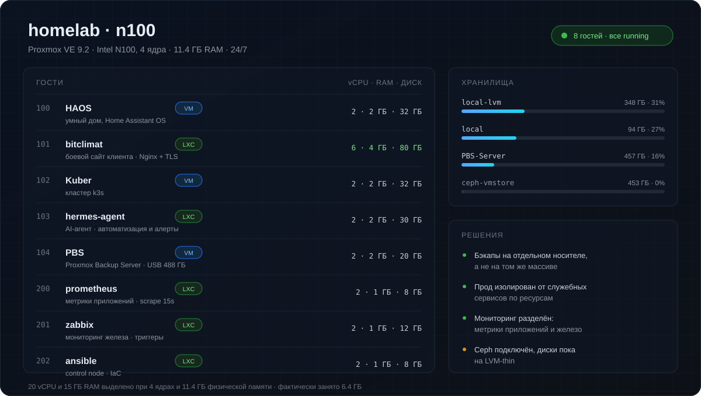

  

  <a href="mailto:it-3@yandex.ru">it-3@yandex.ru</a>

## Кто я

Linux / DevOps-инженер, **3+ года практики**. Отвечаю за инфраструктуру целиком: от гипервизора и сети до мониторинга и восстановления из бэкапа. Всё, что описано ниже, работает не в теории — на моём узле прямо сейчас.

Ищу роль **Linux / DevOps / SRE** в Санкт-Петербурге или удалённо.

## Инфраструктура

Схема собрана из API узла, а не нарисована по памяти: снимок на 1 ноября 2026.

## Проекты

| Проект | Что демонстрирует |
|---|---|
| **[homelab-ansible](https://github.com/IT-DO/homelab-ansible)** | инвентарь по группам, идемпотентные роли, безопасный rollout и `--check` перед продом |
| **[k3s-manifests](https://github.com/IT-DO/k3s-manifests)** | примитивы Kubernetes: Deployment, Service, Ingress, PVC, requests/limits |
| **[homelab-docker](https://github.com/IT-DO/homelab-docker)** | compose-стек с reverse proxy и метриками; порты закрыты, пароль обязателен |
| **[crypto-monitor](https://github.com/IT-DO/crypto-monitor)** | Python и внешнее API: планировщик, бэктест, алерты в Telegram |

## Стек

| Домен | Инструменты |
|---|---|
| **ОС** | Linux (Ubuntu, CentOS, Debian), Windows Server |
| **Виртуализация** | Proxmox VE, VMware, Hyper-V |
| **Контейнеры** | Docker, Kubernetes (k3s), Docker Compose |
| **Мониторинг** | Prometheus, Grafana, Zabbix, Alertmanager |
| **Автоматизация** | Ansible, Bash, Python, Git |
| **Веб / сеть** | Nginx, Traefik, TLS, DNS, DHCP, VLAN, VPN, firewall |
| **Прочее** | PostgreSQL, SQL Server, Active Directory, REST API, Ceph |

## Принципы

- **Сначала `--check`, потом прод.** Изменения проверяются до применения, а не после инцидента.
- **Через Git, а не руками.** Консольные правки — исключение, которое потом всё равно попадает в репозиторий.
- **Секреты — только в переменных окружения.** В коде и README их нет — это проверяется сканером перед публикацией.
- **README — часть работы.** Схема, запуск, ограничения: чтобы через полгода не расшифровывать собственные конфиги.
- **Ручную операцию, повторённую трижды, превращаю в роль или скрипт.**

---

Резюме, рекомендации и разбор любого проекта — по запросу.

