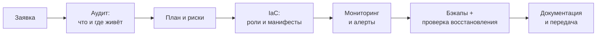

<picture>
  <source media="(prefers-color-scheme: dark)" srcset="assets/hero.svg?v=3">
  <source media="(prefers-color-scheme: light)" srcset="assets/hero-light.svg?v=3">
  
</picture>

  <a href="mailto:it-3@yandex.ru">it-3@yandex.ru</a> ·
  <a href="#инфраструктура">инфраструктура</a> ·
  <a href="#проекты">проекты</a> ·
  <a href="#опыт">опыт</a>

> [!TIP]
> **Открыт к предложениям** · Linux / DevOps / SRE, junior–middle · Санкт-Петербург (офис или гибрид) либо удалённо.

## Кто я

Прихожу туда, где инфраструктура держится на памяти одного человека, и превращаю её в воспроизводимую: код, мониторинг, бэкапы, документация.

- **3+ года фриланса.** Серверы двух интернет-магазинов: 55 000 SKU, миграции без простоя, дежурство по инцидентам.
- **Прод, а не песочница.** Сайт, k3s, мониторинг и бэкапы работают на моём узле круглосуточно — схема ниже собрана из живого API.
- **Инфраструктура как код.** Ansible-роли, манифесты, `--check` перед продом; секреты только в переменных окружения.

## Инфраструктура

<picture>
  <source media="(prefers-color-scheme: dark)" srcset="assets/homelab.svg?v=3">
  <source media="(prefers-color-scheme: light)" srcset="assets/homelab-light.svg?v=3">
  
</picture>

Не рисунок «для красоты»: значения сняты с узла через API.[^1]

## Проекты

| Проект | Что доказывает |
|---|---|
| **[homelab-ansible](https://github.com/IT-DO/homelab-ansible)** | инвентарь по группам, идемпотентные роли, безопасный rollout и `--check` перед продом |
| **[k3s-manifests](https://github.com/IT-DO/k3s-manifests)** | примитивы Kubernetes: Deployment, Service, Ingress, PVC, requests/limits |
| **[homelab-docker](https://github.com/IT-DO/homelab-docker)** | compose-стек с reverse proxy и метриками; порты закрыты, пароль обязателен |
| **[crypto-monitor](https://github.com/IT-DO/crypto-monitor)** | Python и внешнее API: планировщик, бэктест, алерты в Telegram |

## Стек

| Домен | Инструменты |
|---|---|
| **ОС** | Linux (Ubuntu, CentOS, Debian), Windows Server |
| **Виртуализация** | Proxmox VE, VMware, Hyper-V |
| **Контейнеры** | Docker, Kubernetes (k3s), Docker Compose |
| **Мониторинг** | Prometheus, Grafana, Zabbix, Alertmanager |
| **Автоматизация** | Ansible, Bash, Python, Git |
| **Веб / сеть** | Nginx, Traefik, TLS, DNS, DHCP, VLAN, VPN, firewall |
| **Прочее** | PostgreSQL, SQL Server, Active Directory, REST API, Ceph |

## Опыт

<b>Фриланс с 2023 и homelab — подробнее</b>

| Период | Роль | Задачи |
|---|---|---|
| фев 2023 — н.в. | Инфраструктура, фриланс | `ultra-med.ru`, `bitclimat.ru`: серверы, деплой, TLS, бэкапы, миграции без простоя |
| 2023 — н.в. | Homelab 24/7 | Proxmox VE, k3s, Prometheus/Zabbix, PBS, Ansible — стенд, на котором проверяются решения до прода |

Как обычно идёт работа:

---

**Резюме, рекомендации и разбор любого проекта — по запросу.** 
Готов к техническому интервью и разбору домашнего стенда в прямом эфире.

[^1]: `GET /api2/json/cluster/resources` на `192.168.10.2`, Proxmox VE 9.2, снимок от 1 ноября 2026.
