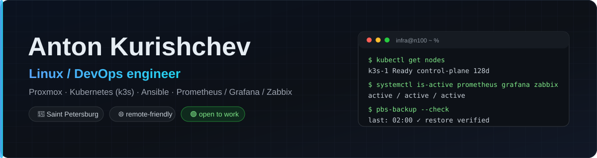
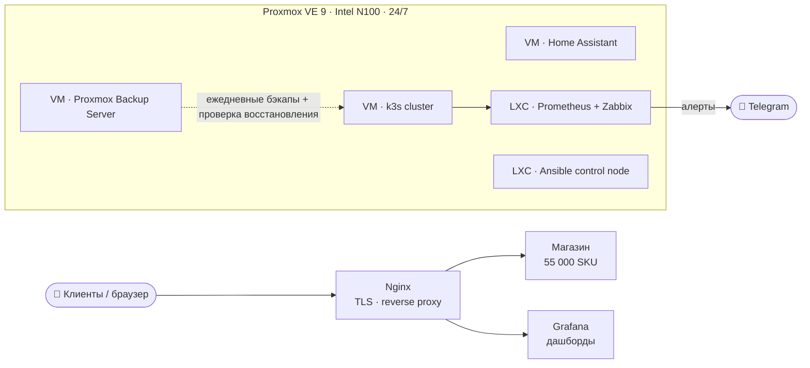

  

  
  
  

---

## Кто я

Linux / DevOps-инженер, **3+ года практики**. Строю и обслуживаю инфраструктуру как код: виртуализация, Kubernetes, мониторинг, бэкапы, автоматизация. Веду собственный homelab **24/7** — это не учебный стенд, а рабочая среда с боевой нагрузкой.

Ищу роль **Linux / DevOps / SRE** в Санкт-Петербурге или удалённо.

## Homelab 24/7 — инфраструктура, которую видно

| Компонент | Что сделано |
|---|---|
| **Виртуализация** | Proxmox VE 9 на Intel N100: 3 VM + 5 LXC, 24/7 |
| **Kubernetes** | кластер k3s: деплой, обслуживание, манифесты (Deployment/Service/Ingress/PVC) |
| **Мониторинг** | Prometheus + Grafana + Zabbix, алерты по триггерам в Telegram |
| **Бэкапы** | Proxmox Backup Server: ежедневные инкрементальные, с проверкой восстановления |
| **Автоматизация** | Ansible (роли, инвентарь, `--check`), скрипты Bash/Python |
| **Сеть** | VLAN, VPN, firewall, DHCP, DNS |

## Проекты

| Проект | Стек | Что демонстрирует |
|---|---|---|
| **[crypto-monitor](https://github.com/IT-DO/crypto-monitor)** | Python · Binance API · Telegram | мониторинг рынка, бэктест и paper-trading: работа с внешним API, планировщик, алерты |
| **[homelab-ansible](https://github.com/IT-DO/homelab-ansible)** | Ansible | инфраструктура как код: инвентарь по группам, идемпотентные роли, безопасный rollout |
| **[k3s-manifests](https://github.com/IT-DO/k3s-manifests)** | Kubernetes | примитивы k8s: Deployment, Service, Ingress (Traefik), PVC, requests/limits |
| **[homelab-docker](https://github.com/IT-DO/homelab-docker)** | Docker Compose | сервисный стек: reverse proxy, Prometheus, Grafana, node-exporter |

## Стек

| Домен | Инструменты |
|---|---|
| **ОС** | Linux (Ubuntu, CentOS, Debian), Windows Server |
| **Виртуализация** | Proxmox VE, VMware, Hyper-V |
| **Контейнеры** | Docker, Kubernetes (k3s), Docker Compose |
| **Мониторинг** | Prometheus, Grafana, Zabbix, Alertmanager |
| **Автоматизация** | Ansible, Bash, Python, Git |
| **Веб / сеть** | Nginx, Traefik, TLS, DNS, DHCP, VLAN, VPN, firewall |
| **Прочее** | PostgreSQL, SQL Server, Active Directory, REST API, Ceph |

## Как я работаю

- **Всё как код.** Конфиги и манифесты в Git, ручные правки — исключение, а не правило.
- **Мониторинг с первого дня.** Сервис без метрик и алертов — это сервис, о падении которого узнают пользователи.
- **Бэкап без проверки восстановления — не бэкап.** Регулярно восстанавливаю из копий.
- **Сначала `--check`.** На хостах с боевой нагрузкой изменения проверяются до применения.
- **Документирую.** README в каждом репозитории: схема, запуск, ограничения.

## GitHub

  
  

---

**Открыт к работе** · Linux / DevOps / SRE · Санкт-Петербург / удалённо

[it-3@yandex.ru](mailto:it-3@yandex.ru) · резюме по запросу

