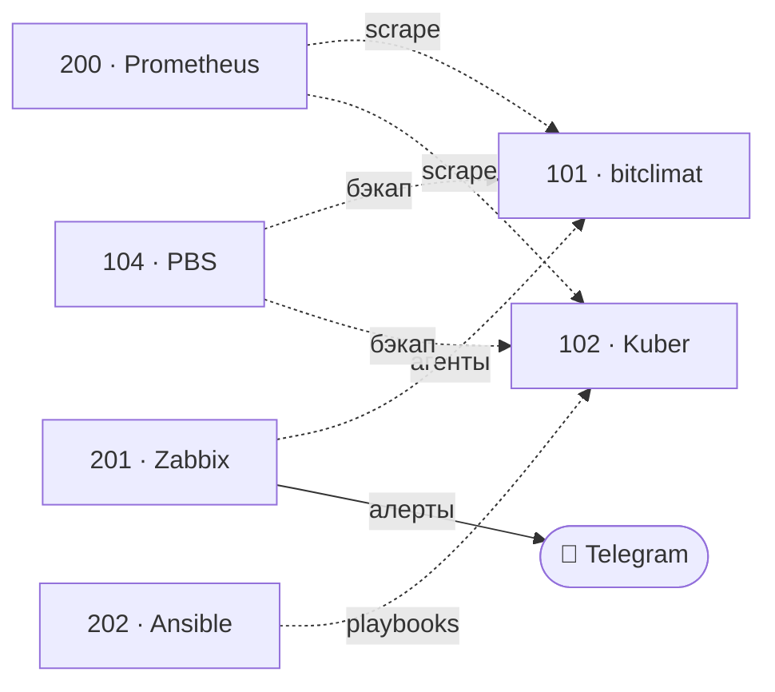

  

  
  
  

---

## Кто я

Linux / DevOps-инженер, **3+ года практики**. Строю и обслуживаю инфраструктуру как код: виртуализация, Kubernetes, мониторинг, бэкапы, автоматизация. Веду собственный homelab **24/7** — это не учебный стенд, а рабочая среда с боевой нагрузкой.

Ищу роль **Linux / DevOps / SRE** в Санкт-Петербурге или удалённо.

## Homelab 24/7 — 8 гостей на одном N100

**Proxmox VE 9.2** · узел `n100` · Intel N100, 4 ядра · 11.4 ГБ RAM · 8 гостей, все running

| VMID | Гость | Тип | vCPU | RAM | Диск | Роль |
|---|---|---|---|---|---|---|
| 100 | HAOS | VM | 2 | 2 ГБ | 32 ГБ | умный дом (Home Assistant OS) |
| 101 | bitclimat | LXC | 6 | 4 ГБ | 80 ГБ | боевой сайт клиента: Nginx + TLS |
| 102 | Kuber | VM | 2 | 2 ГБ | 32 ГБ | кластер k3s |
| 103 | hermes-agent | LXC | 2 | 2 ГБ | 30 ГБ | AI-агент: автоматизация и алерты |
| 104 | PBS | VM | 2 | 2 ГБ | 20 ГБ + 488 ГБ USB | Proxmox Backup Server |
| 200 | prometheus | LXC | 2 | 1 ГБ | 8 ГБ | метрики приложений, scrape 15s |
| 201 | zabbix | LXC | 2 | 1 ГБ | 12 ГБ | мониторинг железа, триггеры |
| 202 | ansible | LXC | 2 | 1 ГБ | 8 ГБ | control node, IaC |

Суммарно выделено **20 vCPU и 15 ГБ RAM** при 4 физических ядрах и 11.4 ГБ памяти. Фактически занято 6.4 ГБ: переподписка 5:1 по CPU держится за счёт того, что все гости, кроме прода, — лёгкие LXC с 1–2 ГБ.

| Хранилище | Тип | Объём | Занято | Что лежит |
|---|---|---|---|---|
| `local-lvm` | LVM-thin | 348 ГБ | 31% | диски всех 8 гостей |
| `local` | dir | 94 ГБ | 27% | ISO и шаблоны |
| `PBS-Server` | PBS | 457 ГБ | 16% | инкрементальные бэкапы гостей |
| `ceph-vmstore` | RBD | 453 ГБ | 0% | Ceph-пул развёрнут, гостевых дисков на нём пока нет |

**Что здесь инженерного, а не «поставил и забыл»:**

- **Бэкапы вынесены с основного диска.** PBS — отдельная VM с проброшенным USB-диском на 488 ГБ, а не папка на том же LVM: потеря основного массива не уносит бэкапы.
- **Мониторинг разделён по задачам.** Prometheus собирает метрики приложений (scrape 15s), Zabbix — состояние железа и триггеры; алерты уходят в Telegram.
- **Прод изолирован.** Боевой сайт живёт в отдельном контейнере с 6 vCPU и 4 ГБ, ресурсы под него не конкурируют со служебными сервисами.
- **Всё как код.** Ansible-контроллер (`202`) внутри инфраструктуры, инвентарь и роли в Git, `--check` перед применением.
- **Ceph развёрнут, но диски пока на LVM-thin.** Пул `ceph-vmstore` подключён и пуст — переезд не выдаётся за сделанное.

## Проекты

| Проект | Стек | Что демонстрирует |
|---|---|---|
| **[crypto-monitor](https://github.com/IT-DO/crypto-monitor)** | Python · Binance API · Telegram | мониторинг рынка, бэктест и paper-trading: работа с внешним API, планировщик, алерты |
| **[homelab-ansible](https://github.com/IT-DO/homelab-ansible)** | Ansible | инфраструктура как код: инвентарь по группам, идемпотентные роли, безопасный rollout |
| **[k3s-manifests](https://github.com/IT-DO/k3s-manifests)** | Kubernetes | примитивы k8s: Deployment, Service, Ingress (Traefik), PVC, requests/limits |
| **[homelab-docker](https://github.com/IT-DO/homelab-docker)** | Docker Compose | сервисный стек: reverse proxy, Prometheus, Grafana, node-exporter |

## Стек

| Домен | Инструменты |
|---|---|
| **ОС** | Linux (Ubuntu, CentOS, Debian), Windows Server |
| **Виртуализация** | Proxmox VE, VMware, Hyper-V |
| **Контейнеры** | Docker, Kubernetes (k3s), Docker Compose |
| **Мониторинг** | Prometheus, Grafana, Zabbix, Alertmanager |
| **Автоматизация** | Ansible, Bash, Python, Git |
| **Веб / сеть** | Nginx, Traefik, TLS, DNS, DHCP, VLAN, VPN, firewall |
| **Прочее** | PostgreSQL, SQL Server, Active Directory, REST API, Ceph |

## Как я работаю

- **Всё как код.** Конфиги и манифесты в Git, ручные правки — исключение, а не правило.
- **Мониторинг с первого дня.** Сервис без метрик и алертов — это сервис, о падении которого узнают пользователи.
- **Бэкап без проверки восстановления — не бэкап.** Регулярно восстанавливаю из копий.
- **Сначала `--check`.** На хостах с боевой нагрузкой изменения проверяются до применения.
- **Документирую.** README в каждом репозитории: схема, запуск, ограничения.

## GitHub

  
  

---

**Открыт к работе** · Linux / DevOps / SRE · Санкт-Петербург / удалённо

[it-3@yandex.ru](mailto:it-3@yandex.ru) · резюме по запросу

